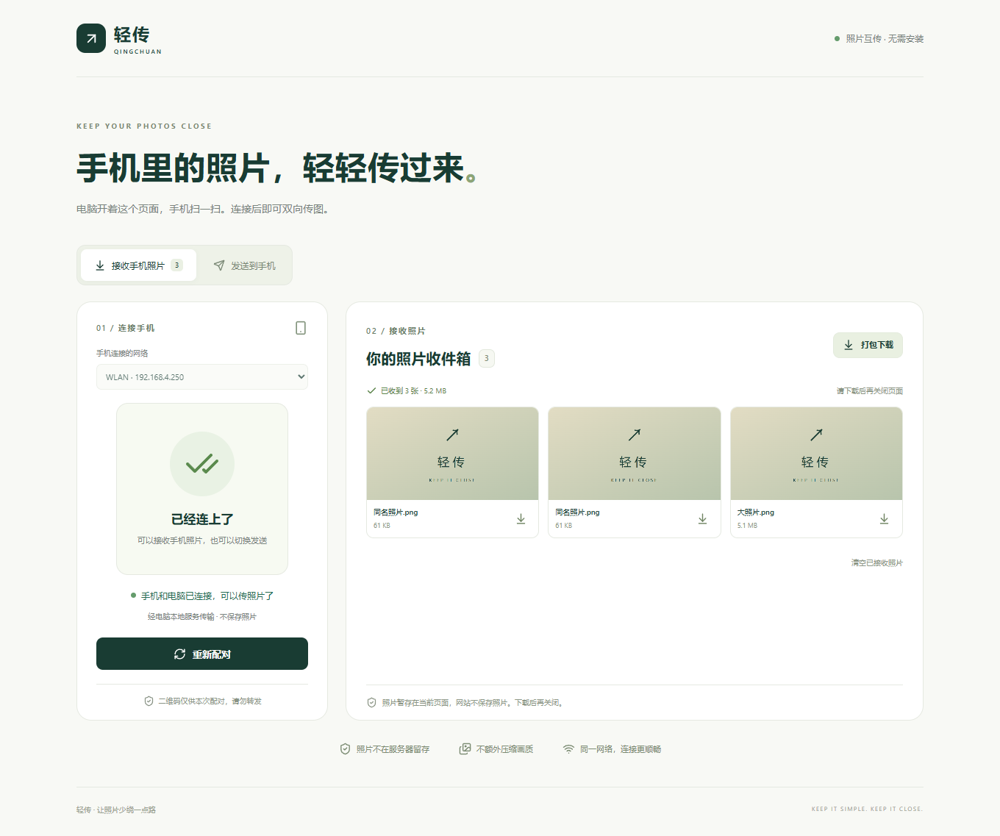
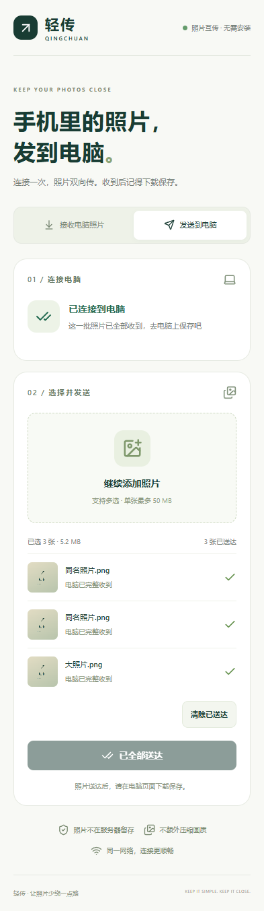

<div align="center">


# 轻传 · Qingchuan

**电脑与手机，扫码就能传照片。**

局域网双向传图 · 手机无需安装 App · 无需账号

电脑端：Windows x64 · 手机端：浏览器

[快速开始](#快速开始) · [使用说明](docs/使用说明.md) · [开发文档](docs/开发说明.md) · [版本发布](https://github.com/snowcgj/qingchuan/releases)

</div>

---

拍了照片想放到电脑，或想把电脑里的图片送到手机？打开轻传，扫码连接，选好照片就能发送。连接一次，两边都能传，让照片少绕一点路。



<details>
<summary>查看手机端界面</summary>

<p align="center"></p>

</details>

*截图使用测试图片展示界面。*

## 轻传能做什么

| 连接简单 | 两边都能传 | 原图与批量保存 |
| :--- | :--- | :--- |
| 电脑启动，手机扫码；同一 Wi-Fi 或热点即可 | 手机多选发送，电脑也可选图或拖入照片 | 预览、单张下载、ZIP 打包，工具不额外缩放或压缩图片 |

- **连接一次，双向传图。** 切换收发不用重新扫码，也支持两端同时发送。
- **知道照片是否送达。** 显示进度，内容校验一致后才显示完整收到。
- **手机只用浏览器。** 图片可用普通 HTTP 链接下载，也可打开原图后长按保存。
- **文件留在自己的设备间。** 不上传云端；电脑上的服务只做内存转发和短期下载缓存。

## 快速开始

### 使用 Windows 便携版

**[下载 Windows x64 便携版 v0.1.0](https://github.com/snowcgj/qingchuan/releases/download/v0.1.0/qingchuan-0.1.0-windows-x64.zip)** · [版本说明与校验文件](https://github.com/snowcgj/qingchuan/releases/tag/v0.1.0)

拿到便携 ZIP 后，只需三步：

1. **解压并启动**：解压整个文件夹，双击 `启动轻传.cmd`，电脑会打开本地页面。
2. **扫码连接**：两台设备连同一 Wi-Fi 或热点，电脑点击「开启接收」，手机扫码并连接。
3. **选图互传**：选择发送方向，发送照片；接收端下载保存。

便携版自带运行时，无需另装 Node.js 或手机 App。用完双击 `停止轻传.cmd`。网卡选择、下载位置和常见问题见[使用说明](docs/使用说明.md)。

### 从源码运行

需要 **Node.js ≥ 22.18.0** 和 npm。在项目目录运行：

```sh
npm ci
npm run build
npm start
```

电脑打开 `http://127.0.0.1:4317`，手机扫码连接。开发、检查和打包命令见[开发文档](docs/开发说明.md)。

## 保存照片前，了解这几件事

- **多图优先下载 ZIP**：一个下载任务能减少逐张确认，解压后得到原图；分别下载仍可能由浏览器逐张询问。
- **收到不等于保存到相册**：请在手机的下载记录或文件管理中确认结果。相册是否显示，取决于手机和浏览器。
- **面向可信局域网**：当前 HTTP / WebSocket 不加密，不提供公网中转。
- **当前上限**：单张 50 MiB，每批最多 100 张、合计 200 MiB；传输时保持页面打开。

临时下载链接、数据保留和其他限制详见[使用说明](docs/使用说明.md#数据与使用边界)。

## 技术一览

| 页面 | 本地服务 | 文件处理 | 构建与发行 |
| --- | --- | --- | --- |
| React、TypeScript、CSS | Node.js、WebSocket、内存 SQLite | SHA-256、二维码、ZIP | Vite、esbuild、Windows 便携包 |

想了解“技术栈”是什么，以及每个组件为什么存在？见[实现与技术栈](docs/开发说明.md#实现与技术栈)。

## 后续方向

- [ ] 改善手机批量保存与相册体验
- [ ] 中断重试、断点续传与后台传输
- [ ] 更简单的可信 HTTPS 连接
- [ ] 干净 Windows 环境验证与更多平台发行

以上是后续计划。当前不支持任意文件 / 文件夹、视频、公网中转或自动批量写入系统相册。

---

<div align="center">轻传 · 让照片少绕一点路</div>
